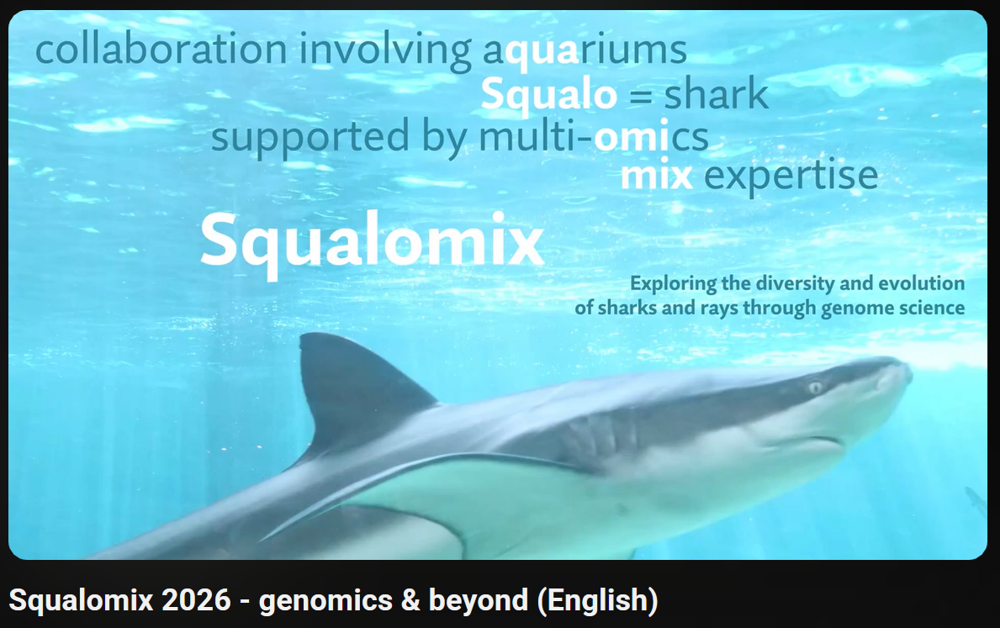

# Squalomix - shark genomics and beyond

Cartilaginous fishes (sharks, rays, chimaeras) charted an evolutionary trajectory distinct from other lineages. Not simply generalized as "fish," these species require dedicated research frameworks to decode their lives. Since 2020, Squalomix has met this need sustainably. Partnering with public aquariums, marine stations, and allied consortia, we study diverse species—from migratory pelagic sharks to our core focus, Japanese coastal biodiversity.

More about the consortium: [About](about.md). Our outputs are collected under [Data & Tools](data.md), the species we work on under [Species](species.md), and our papers under [Publications](publications.md).

## Latest updates

| Year-Month | Event |
| --- | --- |
| 2026 Sep | Our opsin study presented at [21st Intl Conf Retinal Proteins (ICRP)](https://www.congressi.unisi.it/retinalproteins2026/) held in Siena, Italy |
| 2026 May | Our [PCR-based sexing preprint](https://www.biorxiv.org/content/10.64898/2026.05.02.722412v1) released at bioRxiv |
| 2026 May | Our activity introduced at [Sharks International 2026](https://si2026.org/) held in Colombo, Sri Lanka |
| 2025 Aug | Our activity introduced at [International Basking Shark Conference](https://www.baskingshark.ie/conference2025) in Galway, Ireland |
| 2025 Aug | Our activity introduced at [Congress of the European Society of Evolutionary Biology (ESEB)](https://eseb2025.com/) in Barcelona, Spain |

Full chronology: [About](about.md).

## Access to our products

- [NCBI BioProject entry](https://www.ncbi.nlm.nih.gov/bioproject/PRJNA707598) — all sequence data produced by the consortium
- [Squalomix sequence archive](https://treethinkers.nig.ac.jp/squalomix/) with [BLAST search](https://treethinkers.nig.ac.jp/squalomix/blast/) (NIG); earlier archive at [RIKEN](https://transcriptome.riken.jp/squalomix/)
- Gene expression profiles based on published RNA-seq data ([cloudy catshark](https://figshare.com/articles/dataset/Scyliorhinus_torazame_gene_expression_profiles_v1/20549586); [brownbanded bamboo shark](https://figshare.com/articles/dataset/Chilocyllium_punctatum_gene_expression_profiles_v1/20549634))
- Repository pages on this site — genome sizes, karyotypes, protocols and more: see the menu on the left

Citation: [Nishimura et al. 'Squalomix: shark and ray genome analysis consortium and its data sharing platform' F1000Res, 2022](https://f1000research.com/articles/11-1077).

For updates, follow us on [Bluesky](https://bsky.app/profile/kurakulabmsm.bsky.social) and [X](https://x.com/Squalomix4earth).

*Last updated: (mock — set on build)*
